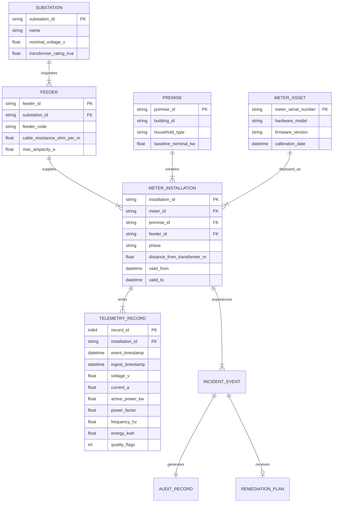
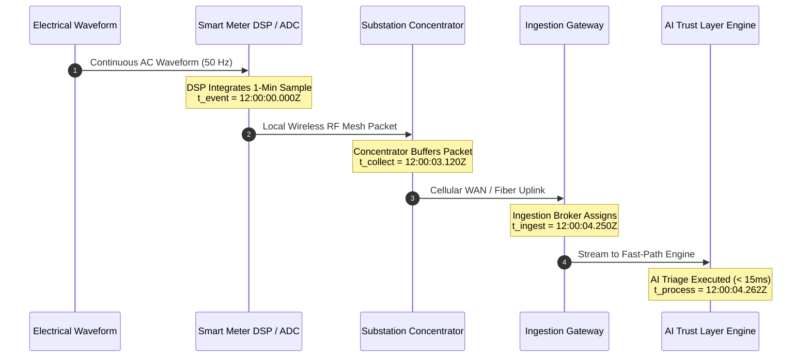

# EnergyMind Tunisia — Complete Data Foundation Specification & Physical Modeling Architecture

> **Document Target:** `DATA_FOUNDATION_SPECIFICATION.md`  
> **Role:** Principal Data Architect, Senior Data Engineer, Machine Learning Data Specialist, Power Systems Data Engineer & Critical Systems Data Reviewer  
> **Challenge Context:** IEEE TSYP 14 (PES & IES Chapters) — *EnergyMind Tunisia: Architects of the Energy Noosphere*  
> **Document Status:** Authoritative Master Data Specification (Stage 1 Deliverable)  
> **Scope:** Definitive Data Foundation, Physical Grid Telemetry, Asset Topology, Temporal Semantics, Quality States, and Ground-Truth Labeling  

---

## 1. Executive Summary

The integrity of any artificial intelligence system operating on critical electrical distribution infrastructure is bounded by the mathematical, physical, and temporal fidelity of its underlying data foundation. In an operational smart grid, an AI model that receives miscalibrated units, unaligned timestamps, or unvalidated physical measurements will produce catastrophic control decisions—either erroneously tripping customer circuit breakers during benign morning demand surges (automation bias) or ignoring real distribution transformer insulation breakdowns and stealth electricity diversion (alert fatigue).

This document establishes the **definitive data foundation for EnergyMind Tunisia**. It transitions the project from ad-hoc CSV/script generation to an **immutable, physically grounded, contract-first data architecture**.

### Foundational Principles Established in this Specification

1. **Strict Electrical Domain Fidelity:** Every electrical measurement ($V, I, P, PF, f, E$) is defined with exact physical SI units, sensor acquisition mechanisms, discrete time resolutions, and hard physical boundaries derived from single-phase alternating current (AC) circuit theory and the Tunisian Société Tunisienne de l'Électricité et du Gaz (STEG) low-voltage distribution code.
2. **Decoupling of Asset, Premise, and Topology:** We eliminate the naive conflation of `meter_id` with customer premise and feeder location. We establish a 3-tier entity model: Physical Assets (Meters/CTs), Geographical Sites (Premises/Buildings), and Electrical Topology (Transformers/Feeders/Phases) with temporal validity tracking to support feeder reconfiguration.
3. **Rigorous Dual-Clock Temporal Semantics:** Telemetry records explicitly distinguish between **Event Time** ($t_{\text{event}}$, physical ADC sampling timestamp at the meter) and **Ingestion Time** ($t_{\text{ingest}}$, gateway arrival timestamp). Clock drift, packet network latency, and out-of-order delivery are bounded by deterministic validation rules.
4. **Explicit 7-State Data Quality Model:** Telemetry records never silently impute or overwrite corrupted or missing sensor signals with arbitrary sentinel numbers (e.g., `-999.0` or `0.0`). Instead, we specify an explicit, bitmasked Data Quality Status enumerator (`VALID`, `MISSING`, `OUT_OF_BOUNDS`, `DEGRADED`, `STALE`, `REPLAYED`, `CORRUPTED`).
5. **Decoupled Ground-Truth & Feature Boundaries:** Raw streaming telemetry schemas are strictly quarantined from ground-truth scenario labels and downstream ML feature vectors, preventing accidental training leakage and schema pollution.

---

## 2. Repository and Existing-Data Investigation

An exhaustive empirical investigation of the existing codebase (`src/gridsentinel/`), data directories (`data/generated/`, `data/processed/`, `data/stage2_balanced/`), and test suites was conducted to benchmark the current implementation against domain requirements.

### 2.1 File & Artifact Inventory

```
data/
├── generated/                          # Baseline synthetic generation (Prototype Phase 1)
│   ├── normal_training.csv             # 43,200 rows (1 day, 30 meters, 1-min interval)
│   ├── scored_demo.csv                 # 43,200 rows with 30 columns (raw + features + verdicts)
│   ├── labels.csv                      # 13 injected anomaly scenario metadata rows
│   ├── audit_log.csv                   # 39 simulated governance event audit rows
│   ├── pattern_registry.json           # 4 shared Noosphere JSON pattern signatures
│   └── summary.csv                     # Cross-tabulation of event types vs verdicts
│
├── processed/                          # Stage 1 ML Row-Level Pipeline (7-Day Duration)
│   ├── train.parquet / train.csv       # 211,680 rows (70% chronological split, 28 features)
│   ├── val.parquet / val.csv           # 45,360 rows (15% chronological split)
│   ├── test.parquet / test.csv         # 45,360 rows (15% chronological split)
│   ├── llm_instruction_dataset.jsonl   # 1,350 ChatML instruction-tuning pairs
│   └── dataset_metadata.json           # Split metadata, time ranges, and 5-class weights
│
└── stage2_balanced/                    # Stage 2 Balanced Episode Dataset (2,800 Episodes)
    ├── train.parquet / train.csv       # 1,960 episodes (140/class across 14 classes, 48 features)
    ├── val.parquet / val.csv           # 420 episodes (30/class across 14 classes)
    ├── test.parquet / test.csv         # 420 episodes (30/class across 14 classes)
    ├── llm_instruction_dataset.jsonl   # 2,800 4-stage Chain-of-Thought ChatML pairs
    ├── dataset_metadata.json           # Disjoint seed blocks (1000-1699, 1700-1849, 1850-1999)
    └── schema.json                     # Strongly typed PyArrow column contract
```

### 2.2 Deep Investigation of Existing Data Generation (`simulator.py`)

Inspection of `src/gridsentinel/simulator.py` lines 64–140 reveals the underlying simulation dynamics:

1. **Diurnal Residential Load Modeling:**
   * Diurnal demand is generated via superimposed sinusoidal harmonics modeling weekday morning peaks ($7:00\text{–}8:30$) and evening peaks ($18:30\text{–}22:00$), with a separate weekend pattern:
     $$\text{weekday}(t) = 0.28 + 0.52 \sin^2(\theta_t - 1.15) + 0.78 \sin^2(\theta_t - 4.45)$$
   * Stochasticity is injected via a Gamma distribution: $\text{load}_{\text{random}} \sim \text{Gamma}(k=2.0, \theta=0.10)$.
   * Three distinct household categories are modeled with baseline active powers:
     * `small_flat`: $0.38\text{ kW}$ baseline (bounds $[0.08, 4.5]\text{ kW}$)
     * `family_home`: $0.72\text{ kW}$ baseline
     * `high_usage_home`: $1.05\text{ kW}$ baseline
2. **Substation Bus Voltage & Line Drop Physics:**
   * Substation distribution transformer bus voltage fluctuates diurnally around $230\text{V}$:
     $$V_{\text{substation}}(t) = 230.0 + 1.2 \sin(\theta_t) + \mathcal{N}(0, 0.6^2)$$
   * Radial distance drop is calculated using a constant loop cable resistance $R_{\text{cable}} = 0.0022\,\Omega/\text{m}$ (modeling phase + neutral loop resistance of low-voltage aerial bundled aluminum conductor):
     $$\Delta V_i(t) = R_{\text{cable}} \cdot d_i \cdot I_{\text{approx}, i}(t)$$
     $$V_{\text{terminal}, i}(t) = \text{clip}(V_{\text{substation}}(t) - \Delta V_i(t), \; 195.0\text{V}, \; 253.0\text{V})$$
   * Current is back-calculated via single-phase AC active power:
     $$I_i(t) = \frac{P_i(t) \times 1000}{V_{\text{terminal}, i}(t) \times PF_i(t)}$$
   * Cumulative energy is integrated numerically via discrete rectangular quadrature:
     $$E_i(t) = \sum_{k=0}^t \frac{P_i(k)}{60.0}\quad [\text{kWh}]$$

---

## 3. Verified Current-State Inventory

Based on direct codebase execution, schema inspection, and test results, each existing data component is categorized according to its factual implementation state:

| Component / Artifact | Current State Classification | Exact File / Line Evidence | Analysis & Technical Findings |
|---|:---:|---|---|
| **Raw Telemetry Simulation** | **VERIFIED** | `src/gridsentinel/simulator.py:64-140` | Generates 6 core electrical channels ($V, I, P, PF, f, E$) with radial line drop physics. Deterministic and validated across all tests. |
| **13-Scenario Anomaly Injection** | **VERIFIED** | `src/gridsentinel/simulator.py:207-334` | Full injection coverage for all 13 challenge scenarios. Tested in `tests/test_prototype.py`. |
| **Row-Level ML Dataset (7-Day)** | **VERIFIED** | `data/processed/train.parquet` | 302,400 rows, 28 engineered features, strict chronological 70/15/15 split. Metadata manifest in `dataset_metadata.json`. |
| **Balanced Episode Dataset (Stage 2)** | **VERIFIED** | `data/stage2_balanced/train.parquet` | 2,800 episodes (200/class across 14 classes), 48 engineered features, disjoint random seed blocks. PyArrow schema in `schema.json`. |
| **ChatML Instruction Dataset** | **VERIFIED** | `data/stage2_balanced/*.jsonl` | 2,800 records with 4-stage CoT (Physical Sanity, Spatial Isolation, Disambiguation, Directive). |
| **Data Quality Status Codes** | **MISSING** | `src/gridsentinel/simulator.py` | Data quality is currently implied by `NaN` or out-of-bounds numbers; no explicit quality bitmask or status enum exists. |
| **Asset & Topology Database** | **PARTIALLY IMPLEMENTED** | `src/gridsentinel/simulator.py:98-102` | `meter_id`, `feeder_id`, `building_id`, and `distance_m` exist as flat denormalized strings; no relational asset registry. |
| **Dual-Clock Timestamps** | **MISSING** | `src/gridsentinel/simulator.py:122` | Only single timestamp column exists; no separation between meter sampling time and ingestion time. |
| **Phase Assignment ($L_1, L_2, L_3$)** | **MISSING** | `src/gridsentinel/simulator.py` | All meters are treated as single-phase on a single shared bus; phase identification is not tracked. |
| **Contract-First Schemas** | **SPECIFIED (NOT CODED)** | `PROJECT_MODULAR_ARCHITECTURE.md:709` | Defined as Pydantic CTR-01 to CTR-10 in architectural design; not yet implemented in Python files. |

---

## 4. Data Requirements and Justification

Every field admitted into the EnergyMind data foundation must serve an explicit, mathematically or operationally justified purpose.

> **MS212 Architecture Note:** The Sagemcom MS212 meter — the standard STEG Tunisia deployment — exposes **cumulative energy registers** as its primary output, not instantaneous power samples. Instantaneous quantities (`load_kW`, `phase_current_A`, `power_factor`) are **derived** from register deltas and electrical laws. Raw reactive registers are provided per-quadrant (Q1–Q4), making prior exclusion of reactive data obsolete.

### 4.1 Electrical Telemetry Variables

```
+────────────────────────────────────────────────────────────────────────────────────────────────────────+
|                              ELECTRICAL TELEMETRY SPECTRUM — MS212 NATIVE SCHEMA                      |
+──────────────────────────────┬──────────────────┬──────────────────┬─────────────────────────────────+
| Measurement Variable         | Physical Unit    | Source (MS212)   | Justification & Role           |
+──────────────────────────────┼──────────────────┼──────────────────┼─────────────────────────────────+
| active_import_kWh            | kWh              | RAW — Cumulative | Primary billing register.       |
|                              |                  | energy register  | Delta = load consumed per step. |
| active_export_kWh            | kWh              | RAW — Cumulative | Solar/DER injection register.   |
|                              |                  | energy register  | Zero for grid-only households.  |
| reactive_Q1_kvarh            | kvarh            | RAW — Cumulative | Inductive import (normal load). |
|                              |                  | Q-register       | Enables 4-quadrant PF derivation|
| reactive_Q2_kvarh            | kvarh            | RAW — Cumulative | Inductive export (solar+motor). |
|                              |                  | Q-register       |                                 |
| reactive_Q3_kvarh            | kvarh            | RAW — Cumulative | Capacitive export.              |
|                              |                  | Q-register       |                                 |
| reactive_Q4_kvarh            | kvarh            | RAW — Cumulative | Capacitive import (electronics, |
|                              |                  | Q-register       | capacitor banks).               |
| voltage_V                    | Volts [V]        | RAW — Direct ADC | Feeder sag, cable drop.         |
|                              |                  | (Voltage divider)| Valid: [180, 270] V.            |
| frequency_Hz                 | Hertz [Hz]       | RAW — Zero-cross | Grid stability; transmission    |
|                              |                  | cycle counter    | triage. Valid: [47.5, 52.5] Hz. |
| neutral_current_A            | Amperes [A]      | RAW — Neutral CT | Strongest bypass/swap detector. |
|                              |                  | (Direct measure) | Valid: [0, 80] A.               |
| voltage_interruptions        | count (integer)  | RAW — Event log  | Power-down events in period.    |
| voltage_restorations         | count (integer)  | RAW — Event log  | Power-up events in period.      |
| power_factor_variation       | Boolean (0/1)    | RAW — Event flag | PF change detected by meter.    |
| _detected                    |                  |                  | Triggers PF scalar recompute.   |
| tariff_register              | Enum T1/T2/T3    | RAW — Calendar   | Active TOU tariff window.       |
| breaker_state                | Enum OPEN/CLOSED | RAW — Relay reg. | OPEN + non-zero energy = alert. |
| magnetic_field_detected      | Boolean (0/1)    | RAW — Tamper     | Classic magnet-tamper flag.     |
| top_cover_opened             | Boolean (0/1)    | RAW — Tamper     | Physical meter intrusion.       |
| terminal_cover_opened        | Boolean (0/1)    | RAW — Tamper     | Wiring-access intrusion.        |
| io_swap                      | Boolean (0/1)    | RAW — Tamper     | Supply/load terminal reversed.  |
| phase_neutral_swap           | Boolean (0/1)    | RAW — Tamper     | Phase/neutral wiring reversed.  |
| mains_power_cut              | Boolean (0/1)    | RAW — Event log  | Outage event flag.              |
| neutral_disturbance          | Boolean (0/1)    | RAW — Neutral    | Abnormal neutral conditions.    |
| auto_diagnostic              | Enum OK/WARNING/ | RAW — Internal   | Meter self-test result. Maps    |
|                              | ALARM/ERROR      | self-test        | directly into QualityFlag.      |
| comm_channel                 | Enum G3-PLC /    | RAW — Protocol   | Communication path; used for    |
|                              | Cellular-4G /    | header           | latency modeling & routing.     |
|                              | W-Mbus           |                  |                                 |
+──────────────────────────────┼──────────────────┼──────────────────┼─────────────────────────────────+
| Total Harmonic Distortion    | Percent [%]      | EXCLUDED         | Class 0.2 power quality only;  |
| (THD_V, THD_I)               |                  |                  | prohibitive AMI bandwidth.      |
+──────────────────────────────┴──────────────────┴──────────────────┴─────────────────────────────────+
```

### 4.2 Derived Fields (Computed from Raw MS212 Registers — Not Stored Raw)

The following quantities are **not transmitted by the MS212 as independent channels**; they are computed by the EnergyMind ingestion pipeline from register deltas and electrical laws:

| Derived Field | Formula | Purpose |
|---|---|---|
| `load_kW` | $\Delta \text{active\_import\_kWh} / \Delta t \times 60$ | Instantaneous active power for load curve analysis |
| `export_kW` | $\Delta \text{active\_export\_kWh} / \Delta t \times 60$ | Instantaneous export power for solar/DER detection |
| `phase_current_A` | $\text{load\_kW} \times 1000 \div (V \times PF)$ | Phase current estimate for Ohm's law and line drop |
| `reactive_delta_kvar` | $(\Delta Q1 + \Delta Q2 - \Delta Q3 - \Delta Q4) / \Delta t \times 60$ | Net reactive power from quadrant register deltas |
| `power_factor` | $\text{load\_kW} \div \sqrt{\text{load\_kW}^2 + \text{reactive\_delta\_kvar}^2}$ | Scalar PF derived from Q-register deltas |
| `neutral_imbalance_ratio` | $\text{neutral\_current\_A} \div \text{phase\_current\_A}$ | Primary detector for current bypass, earth fault, and swap anomalies |
| `active_quadrant` | Function of import/export register deltas and dominant Q-register | Operating quadrant (Q1–Q4) at the time of reading |

#### Detailed Physical Evaluation of Core Channels

1. **RMS Voltage ($V_{\text{rms}}$) — `voltage_V`:**
   * *Physical Meaning:* Root-mean-square potential difference across phase conductor and neutral.
   * *Unit:* Volts [V].
   * *Sampling & Precision:* Sampled continuously at internal meter sampling rate ($3.2\text{ kHz}$), averaged and transmitted at 1-minute intervals with $0.1\text{V}$ precision.
   * *Critical Dependencies:* Physics Residuals ($\Delta V = V_{\text{substation}} - R \cdot d \cdot I$), Feeder Consensus (fraction of feeder meters with $V < 212\text{V}$).
2. **Phase Current ($I_{\text{phase}}$) — `phase_current_A` (DERIVED):**
   * *Physical Meaning:* Root-mean-square current magnitude through phase conductor, back-calculated.
   * *Unit:* Amperes [A]. Precision: $0.01\text{A}$.
   * *Critical Dependencies:* Primary driving term in line drop $R \cdot d \cdot I$. Ground-truth signature of inductive equipment breakdown ($I$ surges $2.2\times$ while $PF$ collapses).
3. **Instantaneous Active Power ($P$) — `load_kW` (DERIVED):**
   * *Physical Meaning:* Time-average rate of real energy transfer per interval: $P_k = \Delta E_k / \Delta t \times 60$.
   * *Unit:* Kilowatts [kW]. Precision: $0.001\text{ kW}$ ($1\text{ Watt}$).
   * *Critical Dependencies:* Primary variable for customer demand, stealth theft scaling, and single-phase Ohm's law apparent power balance.
4. **Power Factor ($PF$) — `power_factor` (DERIVED):**
   * *Physical Meaning:* Ratio of real active power to total apparent power: $PF = P / S$.
   * *Unit:* Dimensionless ratio $\in [0.0, 1.0]$.
   * *Derivation:* Computed from Q-register deltas. The MS212 natively provides `power_factor_variation_detected` (boolean event flag); the continuous scalar is reconstructed downstream.
5. **Frequency ($f$) — `frequency_Hz`:**
   * *Physical Meaning:* Fundamental AC oscillation frequency of the synchronous grid.
   * *Unit:* Hertz [Hz]. Precision: $0.01\text{ Hz}$.
   * *Critical Role:* In the Tunisian national grid (synchronized with ENTSO-E / Maghreb system), frequency is a **global system-wide variable**. A localized feeder voltage sag will **not** perturb frequency. Tracking $f$ provides a conclusive veto against misdiagnosing transmission events as distribution equipment faults.
6. **Cumulative Active Energy — `active_import_kWh` / `active_export_kWh`:**
   * *Physical Meaning:* Running totals of energy imported and exported by the meter since installation.
   * *Unit:* Kilowatt-hours [kWh]. Precision: $0.01\text{ kWh}$.
   * *Critical Role:* The constraint $\Delta E_k \approx \frac{P_k \cdot \Delta t}{60}$ catches **energy accumulator manipulation** (`energy_power_mismatch`), where a malicious actor manipulates one register while leaving the other intact.
7. **Neutral Current — `neutral_current_A`:**
   * *Physical Meaning:* Current flowing through the neutral conductor, measured by a dedicated CT.
   * *Unit:* Amperes [A]. Valid range: $[0.0, 80.0]\text{ A}$ (MS212 rated 5(80)A).
   * *Critical Role:* In a healthy single-phase installation, neutral current closely tracks phase current. The **neutral imbalance ratio** $= \text{neutral\_current\_A} / \text{phase\_current\_A}$ is the strongest single indicator of current bypass, earth fault, and phase/neutral swap anomalies.
8. **Per-Quadrant Reactive Registers — `reactive_Q1_kvarh` through `reactive_Q4_kvarh`:**
   * *Physical Meaning:* Cumulative reactive energy accumulated in each of the four power-flow quadrants.
   * *Unit:* kvarh. The active quadrant at any interval is the one whose register incremented.
   * *Critical Role:* Enables derivation of net reactive power, power factor, and operating quadrant without transmitting redundant instantaneous values over the AMI channel.

---

## 5. Canonical Entity Model

The conceptual entity-relationship architecture for EnergyMind Tunisia is defined below:



---

## 6. Complete Field Dictionary

Below is the definitive, unambiguous field dictionary for every core entity in the EnergyMind data foundation. This schema is anchored on the **Sagemcom MS212 meter** as deployed by STEG Tunisia, using the real column layout from `ms212_neighborhood_steg.csv`.

### 6.1 Raw Ingestion Schema (`ms212_telemetry_stream`)

> **Source of truth:** Every field in this table is a native MS212 register or event log entry. No field is computed. Fields marked DERIVED in §4.2 are **not** present here.

#### Identification

| Field Name | Type | Required | Nullable | Engineering Constraints | Source |
|---|:---:|:---:|:---:|---|---|
| `meter_id` | `String` | Yes | No | Format: `^MS212-TN-\d{4}$` | Meter hardware serial |
| `installation_id` | `String` | Yes | No | Format: `^INST_[A-Z0-9]{8}$` | Meter registry lookup |
| `feeder_id` | `String` | Yes | No | Format: `^feeder_\d{2}$` | Topology mapping |
| `event_timestamp` | `Timestamp` | Yes | No | ISO 8601 UTC; within $[-60\text{s}, +5\text{s}]$ of ingest | Meter RTC |
| `ingest_timestamp` | `Timestamp` | Yes | No | $\ge \text{event\_timestamp} - 1\text{s}$ | Ingestion broker |
| `comm_channel` | `Enum` | Yes | No | One of: `G3-PLC`, `Cellular-4G`, `W-Mbus` | Protocol header |

#### Energy Registers (Cumulative — Raw)

| Field Name | Type | Unit | Nullable | Engineering Constraints | Description |
|---|:---:|:---:|:---:|---|---|
| `active_import_kWh` | `Float64` | kWh | Yes | Monotonically increasing $\ge 0.0$; MID Class 1 | Total active energy imported from grid (billing) |
| `active_export_kWh` | `Float64` | kWh | Yes | Monotonically increasing $\ge 0.0$ | Total active energy exported to grid (solar/DER) |
| `reactive_Q1_kvarh` | `Float64` | kvarh | Yes | $\ge 0.0$; IEC Class 2 | Reactive energy — Q1: inductive import |
| `reactive_Q2_kvarh` | `Float64` | kvarh | Yes | $\ge 0.0$ | Reactive energy — Q2: inductive export |
| `reactive_Q3_kvarh` | `Float64` | kvarh | Yes | $\ge 0.0$ | Reactive energy — Q3: capacitive export |
| `reactive_Q4_kvarh` | `Float64` | kvarh | Yes | $\ge 0.0$ | Reactive energy — Q4: capacitive import |

#### Instantaneous Electrical Values (Raw)

| Field Name | Type | Unit | Nullable | Engineering Constraints | Description |
|---|:---:|:---:|:---:|---|---|
| `voltage_V` | `Float32` | V | Yes | Valid: $[180.0, 270.0]$; Corrupt: $> 270$ or $< 0$ | RMS supply voltage at meter terminals |
| `frequency_Hz` | `Float32` | Hz | Yes | Valid: $[47.5, 52.5]$; Nominal: $50.0 \pm 0.2$ | Grid frequency from zero-crossing counter |
| `neutral_current_A` | `Float32` | A | Yes | Valid: $[0.0, 80.0]$; Corrupt: $< 0$ or $> 80$ | Neutral conductor current (direct CT measurement) |

#### Power Quality & Interruption Counts (Raw)

| Field Name | Type | Unit | Nullable | Engineering Constraints | Description |
|---|:---:|:---:|:---:|---|---|
| `voltage_interruptions` | `Int16` | count | No | $\ge 0$ | Power-down events detected in reporting period |
| `voltage_restorations` | `Int16` | count | No | $\ge 0$ | Power-up events detected in reporting period |
| `power_factor_variation_detected` | `Bool` | — | No | `0` or `1` | PF-change event detected by meter firmware |

#### Tariff & Relay State (Raw)

| Field Name | Type | Nullable | Engineering Constraints | Description |
|---|:---:|:---:|---|---|
| `tariff_register` | `Enum(T1, T2, T3)` | No | Must be one of `T1`, `T2`, `T3` | Active Time-of-Use tariff register |
| `breaker_state` | `Enum(OPEN, CLOSED)` | No | `OPEN` with $\Delta E > 0$ triggers anomaly | Built-in relay/circuit breaker state |

#### Tamper & Fraud Detection Flags (Raw)

All tamper flags are binary: `0` = not detected, `1` = detected. No nullable — missing telemetry sets `quality_flags.MISSING_VALUE`.

| Field Name | Type | Tamper Class | Description |
|---|:---:|:---:|---|
| `magnetic_field_detected` | `Bool` | Physical | Strong external magnet detected; classic tamper vector |
| `top_cover_opened` | `Bool` | Physical | Ultrasonically welded top cover opened |
| `terminal_cover_opened` | `Bool` | Physical | Terminal block cover opened; wiring exposed |
| `io_swap` | `Bool` | Wiring | Supply and load terminals reversed |
| `phase_neutral_swap` | `Bool` | Wiring | Phase and neutral conductors reversed |
| `mains_power_cut` | `Bool` | Power | Mains supply loss detected (may be legitimate outage) |
| `neutral_disturbance` | `Bool` | Neutral | Abnormal neutral behaviour detected |

#### Device Health (Raw)

| Field Name | Type | Nullable | Engineering Constraints | Description |
|---|:---:|:---:|---|---|
| `auto_diagnostic` | `Enum(OK, WARNING, ALARM, ERROR)` | No | `ERROR` → sets `QualityFlag.OUT_OF_BOUNDS`; combined with zero registers → `device_fault` label | MS212 internal auto-diagnostic and data-integrity result |
| `quality_flags` | `Int32` | No | Default: $0$ (`VALID`); bitmask per §10 | Validation engine bitmask — augments `auto_diagnostic` |

---

### 6.2 Derived Feature Fields (Computed by Ingestion Pipeline — Not Stored Raw)

| Derived Field Name | Type | Formula | Purpose | Downstream Consumers |
|---|:---:|---|---|---|
| `load_kW` | `Float32` | $\Delta\text{active\_import\_kWh} / \Delta t \times 60$ | Instantaneous active power; replaces former raw `active_power_kw` | Load curve, theft ML |
| `export_kW` | `Float32` | $\Delta\text{active\_export\_kWh} / \Delta t \times 60$ | Instantaneous export power for solar/DER detection | Export classification |
| `reactive_delta_kvar` | `Float32` | $(\Delta Q1 + \Delta Q2 - \Delta Q3 - \Delta Q4) / \Delta t \times 60$ | Net reactive power from quadrant register deltas | PF derivation |
| `power_factor` | `Float32` | $\text{load\_kW} \div \sqrt{\text{load\_kW}^2 + \text{reactive\_delta\_kvar}^2}$ | Scalar PF; valid: $[0.0, 1.0]$ | Inductive fault ML |
| `phase_current_A` | `Float32` | $\text{load\_kW} \times 1000 \div (V \times PF)$ | Phase current estimate for Ohm's law and cable drop | Physics residuals |
| `neutral_imbalance_ratio` | `Float32` | $\text{neutral\_current\_A} \div \text{phase\_current\_A}$ | Primary bypass / earth fault / swap signal; healthy ≈ 1.0 | Fraud ML |
| `active_quadrant` | `Enum(Q1,Q2,Q3,Q4)` | Dominant incremented Q-register + import/export direction | Operating quadrant at the time of reading | Label taxonomy |
| `record_id` | `Int64` | Ingestion broker sequence | Monotonically increasing row identity | Audit, storage |

---

## 7. Relationships and Topology Model

A common failure mode in prototype smart grid projects is hardcoding meter IDs, feeder IDs, and distances into flat CSV files. In an operating utility, meters burn out and are replaced; feeders are switched to balance loads. EnergyMind adopts an explicit relational topology:

```text
┌───────────────────────┐         ┌───────────────────────┐
|      Substation       |         |      Premise/Site     |
|  substation_id (PK)   |         |    premise_id (PK)    |
|  nominal_voltage_v    |         |    building_id        |
|  transformer_kva      |         |    household_type     |
└───────────┬───────────┘         |    address            |
            │ 1                   └───────────┬───────────┘
            │                                 │ 1
            ▼ N                               │
┌───────────────────────┐                     │
|        Feeder         |                     │
|    feeder_id (PK)     |                     │
|    substation_id (FK) |                     │
|    cable_type         |                     │
|    resistance_ohm_m   |                     │
└───────────┬───────────┘                     │
            │ 1                               │
            │                                 │
            ▼ N                               ▼ N
┌─────────────────────────────────────────────────────────┐
|              Meter Installation / Topology Mapping       |
|    installation_id (PK)                                 |
|    meter_id (FK)                                        |
|    premise_id (FK)                                      |
|    feeder_id (FK)                                       |
|    phase (L1, L2, L3)                                   |
|    distance_from_transformer_m                          |
|    valid_from (Timestamp UTC)                           |
|    valid_to (Timestamp UTC, Nullable)                   |
└─────────────────────────────────────────────────────────┘
```

### Topology Dynamics & Historical Preservation

1. **Temporal Topology Versioning:**
   Each `METER_INSTALLATION` record contains `valid_from` and `valid_to` timestamps. When a building is re-switched from `feeder_01` to `feeder_02` on 2026-06-01:
   * The existing record sets `valid_to = '2026-06-01T00:00:00Z'`.
   * A new record is created with `feeder_id = 'feeder_02'` and `valid_from = '2026-06-01T00:00:00Z'`.
   * Historical forensic evaluations query the exact topology that existed at $t_{\text{event}}$.
2. **Phase Allocation ($L_1, L_2, L_3$):**
   In realistic radial low-voltage distribution, residential meters are divided across three phases ($L_1, L_2, L_3$) to balance current loading on the distribution transformer. A voltage sag on phase $L_1$ caused by a local single-phase overload will only depress $L_1$ meters. Explicitly tracking phase ensures spatial consensus is computed across **same-phase feeder peers**, eliminating false grid event classifications.

---

## 8. Temporal Model

EnergyMind enforces strict temporal semantics to prevent out-of-order execution, clock skew errors, and training look-ahead leakage.



### Temporal Consistency Rules

1. **Event Time ($t_{\text{event}}$):**
   * Generated by the smart meter's Real-Time Clock (RTC).
   * Format: ISO 8601 UTC strictly (`YYYY-MM-DDTHH:MM:SS.fffZ`).
   * Used for: Diurnal load baseline indexing, physical Ohm's law checks, and cross-meter feeder consensus alignment.
2. **Ingestion Time ($t_{\text{ingest}}$):**
   * Generated by the server ingestion broker upon packet arrival.
   * Used for: Latency benchmarking, detecting communication link delays, and managing out-of-order packet queues.
3. **Temporal Ingestion Delta ($\Delta t_{\text{latency}}$):**
   $$\Delta t_{\text{latency}} = t_{\text{ingest}} - t_{\text{event}}$$
   * Normal operation: $1.0\text{s} \le \Delta t_{\text{latency}} \le 5.0\text{s}$.
   * Network Delay Warning: $5.0\text{s} < \Delta t_{\text{latency}} \le 60.0\text{s}$ (flagged as `COMMUNICATION_DELAY`).
   * Stale / Out-of-Order Packet: $\Delta t_{\text{latency}} > 60.0\text{s}$ (diverted to out-of-order buffer).
   * Negative Latency ($\Delta t_{\text{latency}} < -1.0\text{s}$): Indicates meter clock drift or future-dated attack (triggers `QualityFlag.CLOCK_DRIFT`).

---

## 9. Physical and Engineering Constraints

The validation layer must enforce boundaries grounded in **electrical circuit laws and international power engineering standards**, rejecting arbitrary guesses:

```
+───────────────────────────────────────────────────────────────────────────────────────────────────+
|                                  PHYSICAL & ENGINEERING BOUNDARIES                                |
+────────────────────────────────────┬─────────────────────────────────┬────────────────────────────+
| Validation Domain                  | Nominal Operating Range         | Hard Physical Impossibility|
+────────────────────────────────────┼─────────────────────────────────┼────────────────────────────+
| Terminal Voltage (230V Nominal)    | 207.0V to 253.0V (EN 50160 ±10%)| V <= 0.0V (Complete Open)  |
|                                    | 195.0V to 207.0V (High Drop)    | V > 270.0V (Dangerous)     |
|                                    | 253.0V to 260.0V (Light Load)   | V = 999.0V (ADC Corrupt)   |
|                                    |                                 | V < 0.0V (Impossible)      |
+────────────────────────────────────┼─────────────────────────────────┼────────────────────────────+
| Neutral / Phase Current            | 0.10A to 60.0A (Standard Load)  | I < 0.0A (Magnitude Only)  |
| MS212 rated 5(80)A                 | 60.0A to 80.0A (Heavy / Peak)   | I > 80.0A (Exceeds MS212   |
| neutral_current_A (direct CT)      |                                 | rated maximum current)     |
| phase_current_A (derived)          |                                 |                            |
+────────────────────────────────────┼─────────────────────────────────┼────────────────────────────+
| Active Power (Residential Premise) | 0.05 kW to 10.0 kW (Standard)   | P < 0.0 kW (import side;   |
| load_kW (derived from Δ energy)    | 10.0 kW to 18.4 kW (Max @80A,  | export_kW handles reverse) |
|                                    | 230V, PF=1.0)                   | P > 18.4 kW (blows fuse)   |
+────────────────────────────────────┼─────────────────────────────────┼────────────────────────────+
| Power Factor (Derived from Q regs) | 0.90 to 0.99 (Modern Inverters) | PF > 1.00 (Violates Physics|
| Supplemented by                    | 0.75 to 0.89 (Standard Motors)  | PF < 0.00 (Impossible)     |
| power_factor_variation_detected    | 0.40 to 0.65 (Degraded Motor)   |                            |
+────────────────────────────────────┼─────────────────────────────────┼────────────────────────────+
| System Frequency (STEG 50 Hz Grid) | 49.80 Hz to 50.20 Hz (Normal)   | f < 45.0 Hz (Grid Collapse)|
|                                    | 47.50 Hz to 52.50 Hz (Emergency)| f > 55.0 Hz (Severe Fault) |
+────────────────────────────────────┼─────────────────────────────────┼────────────────────────────+
| Reactive Registers Q1–Q4 (kvarh)  | Monotonically non-decreasing    | Negative increment (counter|
|                                    | per quadrant; only one dominant | roll-back = tamper signal) |
|                                    | quadrant increments per period  |                            |
+────────────────────────────────────┴─────────────────────────────────┴────────────────────────────+
```

### Mathematical Coupling Constraints

Beyond isolated channel boundaries, alternating-current physics imposes coupled multi-variable relationships:

1. **Single-Phase Ohm's Law Apparent Power Invariant:**
   $$S = \frac{V \cdot I}{1000}\quad [\text{kVA}], \quad P = S \cdot PF = \frac{V \cdot I \cdot PF}{1000}\quad [\text{kW}]$$
   * **Physical Residual** (using derived fields `load_kW`, `phase_current_A`, `power_factor`):
     $$r_P = \left| \text{load\_kW} - \frac{V_{\text{measured}} \cdot \text{phase\_current\_A} \cdot PF}{1000} \right|$$
   * **Engineering Threshold:** Under standard meter measurement tolerances (Class 1.0 meter $\pm 1\%$ error), $r_P \le 0.05\text{ kW}$. A residual $r_P > 0.25\text{ kW}$ indicates either deliberate active power falsification or instrument transformer failure.
2. **Radial Cable Drop Line Impedance Invariant:**
   $$V_{\text{expected}, i} = V_{\text{substation}} - (R_{\text{cable}} \cdot d_i \cdot I_i)$$
   * **Voltage Drop Residual:**
     $$r_V = \left| V_{\text{terminal}, i} - (230.0 - R_{\text{cable}} \cdot d_i \cdot I_i) \right|$$
   * **Engineering Interpretation:** If terminal voltage at a $600\text{m}$ meter sags to $205\text{V}$ while $I = 20\text{A}$, $r_V \approx 0\text{V}$, confirming normal physical cable drop. If voltage drops to $205\text{V}$ while $I = 1\text{A}$, $r_V > 20\text{V}$, flagging an unauthorized tap or high-resistance loose neutral connection.
3. **Discrete Energy Step Calculus:**
   $$\Delta E_{\text{expected}, k} = \frac{P_k}{60.0}\quad [\text{kWh}]$$
   * **Residual:** $r_E = |\Delta E_k - \Delta E_{\text{expected}, k}| \le 0.005\text{ kWh}$. Catches accumulator manipulation.

---

## 10. Data Quality and Integrity Model

Rather than allowing corrupted numbers ($999\text{V}$, $-15\text{V}$) or nulls to crash downstream ML algorithms, EnergyMind establishes an explicit **Data Quality Status Enumeration**:

```python
from enum import IntFlag

class QualityFlag(IntFlag):
    VALID = 0                # Clean, validated measurement
    MISSING_VALUE = 1 << 0   # Telemetry channel missing (NaN / null)
    OUT_OF_BOUNDS = 1 << 1   # Voltage or current violates physical envelope
    PF_INVALID = 1 << 2      # Power factor impossible (> 1.0 or < 0.0)
    FROZEN_ADC = 1 << 3      # Consecutive identical readings run >= 5
    REPLAY_SUSPECT = 1 << 4  # Sequence hash matches historical buffer
    IMPEDANCE_ANOMALY = 1 << 5 # Cable voltage drop violates line impedance
    CLOCK_DRIFT = 1 << 6     # Measurement timestamp out of sync with broker
```

### Quality Processing Contract
* A record with `quality_flags == QualityFlag.VALID` enters the normal Fast-Path ML pipeline.
* A record with `QualityFlag.MISSING_VALUE` or `QualityFlag.OUT_OF_BOUNDS` is intercepted by the pre-filter, preventing corrupted numbers ($999\text{V}$) from distorting rolling averages, and routes immediately to `DATA_QUALITY_ISSUE` triage.

---

## 11. Dataset and Simulation Strategy

To evaluate the trust layer under repeatable, verifiable conditions without endangering live grid assets, EnergyMind employs a **physically coupled multi-day simulator** (`src/gridsentinel/simulator.py`).

### 11.1 Generation Taxonomy

```
+───────────────────────────────────────────────────────────────────────────────────────────+
|                                DATA GENERATION TIERS                                      |
+──────────────────────────┬─────────────────────────────┬──────────────────────────────────+
| Tier                     | Implementation Engine       | Purpose & Validation Role        |
+──────────────────────────┼─────────────────────────────┼──────────────────────────────────+
| Tier 1: Physically Based | Numerical integration of AC | Ground truth for nominal grid    |
| Baseline Simulation      | line drop & diurnal curves  | operations; establishes baseline |
+──────────────────────────┼─────────────────────────────┼──────────────────────────────────+
| Tier 2: Parametric       | Controlled mathematical     | Injects 13 catalogued fault and  |
| Scenario Injection       | perturbations on telemetry  | attack signatures with labels    |
+──────────────────────────┼─────────────────────────────┼──────────────────────────────────+
| Tier 3: Vectorized       | Windowed statistical and    | Synthesizes 48-feature vectors   |
| Feature Aggregation      | residual moment extractor   | for ML classification (Stage 2)  |
+──────────────────────────┼─────────────────────────────┼──────────────────────────────────+
| Tier 4: LLM Instruction  | 4-stage Chain-of-Thought    | Synthesizes 2,800 ChatML pairs   |
| Synthesis                | ChatML generator            | for fine-tuning diagnostic LLMs  |
+──────────────────────────┴─────────────────────────────┴──────────────────────────────────+
```

### 11.2 Reproducibility & Zero-Leakage Guarantee

To prevent catastrophic test data leakage (where models memorize customer profiles, transformer distances, or diurnal noise realizations), the simulation enforces **Disjoint Simulation Seed Blocks**:
* **Train Split (70%):** Seeds `1000` to `1699` (140 episodes per class = 1,960 episodes).
* **Validation Split (15%):** Seeds `1700` to `1849` (30 episodes per class = 420 episodes).
* **Test Split (15%):** Seeds `1850` to `1999` (30 episodes per class = 420 episodes).

---

## 12. Anomaly Labeling and Ground-Truth Model

Ground-truth labels must never be conflated with model predictions. Ground-truth represents the **unambiguous, provable physical condition injected by the simulator or confirmed by utility forensic inspection**.

### 12.1 Multi-Level Labeling Architecture

EnergyMind supports a two-tier labeling taxonomy:

```text
┌────────────────────────────────────────────────────────────────────────────────────────┐
│                        TIER 1: 5-CLASS COMPETITION TAXONOMY                           │
│     [NORMAL]  [GENUINE_GRID_EVENT]  [DATA_QUALITY_ISSUE]  [FALSIFICATION_ATTACK]       │
│                                  [EQUIPMENT_FAULT]                                     │
└───────────────────────────────────────────┬────────────────────────────────────────────┘
                                            │
                                            ▼
┌────────────────────────────────────────────────────────────────────────────────────────┐
│                   TIER 2: 26-CLASS MS212-NATIVE FINE-GRAINED DIAGNOSTICS              │
│                                                                                        │
│  NORMAL GROUP (4 classes — operating quadrant variants)                                │
│  • normal               — Typical import consumption, Q1                              │
│  • normal_export_q2     — Legitimate export (solar PV), Q2 inductive network          │
│  • normal_export_q3     — Legitimate export with capacitive effect, Q3                │
│  • normal_capacitive_q4 — Normal consumption with capacitive loads, Q4                │
│                                                                                        │
│  TAMPER GROUP (6 classes — grounded in MS212 hardware tamper flags)                   │
│  • tamper_magnetic      — magnetic_field_detected=1 → FALSIFICATION_ATTACK            │
│  • tamper_top_cover     — top_cover_opened=1 → FALSIFICATION_ATTACK                   │
│  • tamper_terminal_cover— terminal_cover_opened=1 → FALSIFICATION_ATTACK              │
│  • tamper_io_swap       — io_swap=1 → FALSIFICATION_ATTACK                            │
│  • tamper_phase_neutral_swap — phase_neutral_swap=1 → FALSIFICATION_ATTACK            │
│  • tamper_multiple      — 2+ tamper flags simultaneously → FALSIFICATION_ATTACK       │
│                                                                                        │
│  POWER & GRID QUALITY GROUP (5 classes)                                                │
│  • power_cut            — mains_power_cut=1 → GENUINE_GRID_EVENT                      │
│  • voltage_interruption — voltage_interruptions > threshold → GENUINE_GRID_EVENT      │
│  • undervoltage         — voltage_V << 207V sustained → GENUINE_GRID_EVENT            │
│  • overvoltage          — voltage_V >> 253V sustained → GENUINE_GRID_EVENT            │
│  • frequency_deviation  — frequency_Hz outside [49.5, 50.5] → GENUINE_GRID_EVENT     │
│                                                                                        │
│  NEUTRAL & LOAD GROUP (3 classes)                                                      │
│  • neutral_disturbance  — neutral_disturbance=1 → EQUIPMENT_FAULT                     │
│  • neutral_current_imbalance — neutral_imbalance_ratio far from 1.0 → EQUIPMENT_FAULT │
│  • overcurrent          — phase_current_A near/above 80A rated max → EQUIPMENT_FAULT  │
│                                                                                        │
│  POWER FACTOR GROUP (1 class)                                                          │
│  • poor_power_factor    — power_factor_variation_detected=1 + derived PF < 0.65       │
│                           → EQUIPMENT_FAULT                                            │
│                                                                                        │
│  DATA QUALITY GROUP (6 classes — from §11 simulation)                                 │
│  • meter_drift          — Slow linear transducer degradation → DATA_QUALITY_ISSUE     │
│  • constant_bias        — Fixed offset calibration bias → DATA_QUALITY_ISSUE          │
│  • missing_data         — Comms channel dropout → DATA_QUALITY_ISSUE                  │
│  • dropout              — Total signal collapse → DATA_QUALITY_ISSUE                  │
│  • random_corruption    — Memory / ADC bitflip → DATA_QUALITY_ISSUE                   │
│  • energy_power_mismatch— Accumulator inconsistency → DATA_QUALITY_ISSUE              │
│                                                                                        │
│  DEVICE FAULT GROUP (1 class)                                                          │
│  • device_fault         — auto_diagnostic=ERROR + all-zero registers → DATA_QUALITY   │
└────────────────────────────────────────────────────────────────────────────────────────┘
```

### 12.2 Canonical Ground-Truth Registry Schema (`labels.csv`)

```python
from datetime import datetime
from pydantic import BaseModel, Field

# MS212-native label vocabulary (26 classes across 5 Tier-1 categories)
MS212_LABELS = [
    # Normal
    "normal", "normal_export_q2", "normal_export_q3", "normal_capacitive_q4",
    # Tamper (grounded in MS212 hardware flags)
    "tamper_magnetic", "tamper_top_cover", "tamper_terminal_cover",
    "tamper_io_swap", "tamper_phase_neutral_swap", "tamper_multiple",
    # Power & grid quality
    "power_cut", "voltage_interruption", "undervoltage", "overvoltage", "frequency_deviation",
    # Neutral & load
    "neutral_disturbance", "neutral_current_imbalance", "overcurrent",
    # Power factor
    "poor_power_factor",
    # Data quality
    "meter_drift", "constant_bias", "missing_data", "dropout",
    "random_corruption", "energy_power_mismatch",
    # Device fault
    "device_fault",
]

class GroundTruthEvent(BaseModel):
    event_id: str = Field(..., pattern=r"^[a-zA-Z0-9_]+$")
    event_type: str  # One of the 26 MS212-native fine-grained labels
    category: str    # normal | tamper | power_quality | neutral_load | data_quality | device
    target_entity: str  # e.g. "MS212-TN-0001" or "feeder_01"
    start_time: datetime
    end_time: datetime
    duration_min: int = Field(..., ge=1, le=1440)
    affected_channel: str  # e.g. "active_import_kWh,neutral_current_A"
    severity: float = Field(..., ge=0.0, le=1.0)
    parameters_json: str  # Serialized dict of injected parameters
    ms212_flags_triggered: str  # Comma-separated MS212 tamper/event flags active during event
```

---

## 13. Raw-versus-Derived Data Boundaries

A strict architectural boundary separates raw ingested data from derived analytical features:

```
+───────────────────────────────────────────────────────────────────────────────────────────────────+
|                                DATA PERSISTENCE BOUNDARY TOPOLOGY                                 |
+─────────────────────────────────┬─────────────────────────────────┬───────────────────────────────+
| Layer                           | Included Variables / Fields     | Immutability & Persistence    |
+─────────────────────────────────┼─────────────────────────────────┼───────────────────────────────+
| Raw Ingestion Layer             | timestamp, meter_id, voltage_v, | IMMUTABLE. Persisted in       |
| (Source of Truth)               | current_a, active_power_kw,     | raw append-only storage.      |
|                                 | power_factor, frequency_hz,     | Zero feature derivations.     |
|                                 | energy_kwh, quality_flags       |                               |
+─────────────────────────────────┼─────────────────────────────────┼───────────────────────────────+
| Validated Telemetry Layer       | Raw telemetry + imputed missing | TRANSIENT (In-Memory Buffer)  |
| (Cleaned Pipeline Stream)       | values + normalized floats      | Forwarded to feature pipeline |
+─────────────────────────────────┼─────────────────────────────────┼───────────────────────────────+
| Derived Feature Layer           | 48 features: residuals (r_P,    | TRANSIENT or Parquet Training |
| (Feature Store / ML Matrix)     | r_V, r_E), drift slopes (beta1),| Batches. NEVER stored in raw  |
|                                 | feeder_sag_ratio, cohort_ratios | telemetry tables.             |
+─────────────────────────────────┼─────────────────────────────────┼───────────────────────────────+
| Trust Decision & Audit Layer    | audit_id, verdict, confidence,  | IMMUTABLE. Persisted in       |
| (Governance Log)                | shap_drivers, assigned_tier,    | relational SQLite database.   |
|                                 | operator_action, feedback       |                               |
+─────────────────────────────────┴─────────────────────────────────┴───────────────────────────────+
```

---

## 14. Storage Evaluation and Recommendation

We evaluate storage alternatives based on operational requirements:

```
+───────────────────────────────────────────────────────────────────────────────────────────────────+
|                                  STORAGE TECHNOLOGY EVALUATION                                    |
+───────────────────┬──────────────┬──────────────┬──────────────┬──────────────────────────────────+
| Technology        | Storage Tier | Query Focus  | Scalability  | Verdict & Project Role           |
+───────────────────┼──────────────┼──────────────┼──────────────┼──────────────────────────────────+
| SQLite (WAL Mode) | Relational   | ACID Audit   | Up to 100M   | SELECTED for Local Node Prototype|
|                   | Database     | Forensic Log | records      | Zero-configuration, local demo.  |
+───────────────────┼──────────────┼──────────────┼──────────────┼──────────────────────────────────+
| Apache Parquet    | Columnar     | Analytical   | Billions of  | SELECTED for ML Training Batches |
|                   | Disk Format  | ML Training  | rows (TB/PB) | High compression, PyArrow typed. |
+───────────────────┼──────────────┼──────────────┼──────────────┼──────────────────────────────────+
| TimescaleDB /     | Distributed  | Live Stream  | Millions of  | ROADMAP for Enterprise Sizing    |
| PostgreSQL        | Time-Series  | Telemetry    | meters/sec   | Production STEG pilot deployment.|
+───────────────────┴──────────────┴──────────────┴──────────────┴──────────────────────────────────+
```

---

## 15. Data Lifecycle and Versioning

1. **Hot Telemetry Ring-Buffer (In-Memory / SQLite):** Retains 1-minute streaming telemetry for the preceding **48 hours** for live UI visualization and rolling baseline calculations.
2. **Warm Incident Store (SQLite DB):** All flagged anomalies, operator approvals, and audit records are retained for **5 years** to satisfy utility regulatory accounting standards.
3. **Cold ML Archive (Parquet on Disk / Object Store):** Aggregated 48-feature incident episodes are partitioned chronologically (`year=YYYY/month=MM/split=train/`) and retained indefinitely for model retraining.
4. **Dataset Versioning Protocol:** Every generated dataset artifact carries a companion `dataset_metadata.json` recording generation timestamp, Git commit SHA, generator parameters, and class distribution counts.

---

## 16. Validation and Testing Specification

The correctness of the data foundation must be provable through automated test suites:

### 16.1 Structural & Schema Compliance Tests
* **Schema Contract Test:** All incoming telemetry records must pass Pydantic validation against `CTR-01` (`MS212TelemetryRecord`) with zero type coercions.
* **Identifier Format Test:** Regex validation ensuring `meter_id` matches `^MS212-TN-\d{4}$` and `feeder_id` matches `^feeder_\d{2}$`.
* **Tamper Flag Integrity Test:** All 7 tamper boolean columns (`magnetic_field_detected`, `top_cover_opened`, `terminal_cover_opened`, `io_swap`, `phase_neutral_swap`, `mains_power_cut`, `neutral_disturbance`) must be strictly `0` or `1`; any other value sets `QualityFlag.MISSING_VALUE`.
* **Reactive Register Monotonicity Test:** Assert that for each `meter_id`, all four Q-register values are non-decreasing across consecutive readings. A decrement triggers `QualityFlag.IMPEDANCE_ANOMALY`.

### 16.2 Physical Constraint Tests
* **Ohm's Law Sanity Test:** For any record with `QualityFlag.VALID`, assert $|\text{load\_kW} - \frac{V \cdot \text{phase\_current\_A} \cdot PF}{1000}| \le 0.05\text{ kW}$.
* **Cable Line Drop Sanity Test:** Assert terminal voltage satisfies $V_{\text{terminal}} \le V_{\text{substation}}$. Voltage sag must correlate positively with distance from transformer $d$ and derived load current `phase_current_A`.
* **Neutral Imbalance Sanity Test:** For `QualityFlag.VALID` records with no tamper flags, assert `neutral_imbalance_ratio` $\in [0.85, 1.15]$.
* **Breaker Consistency Test:** Assert that `breaker_state == OPEN` implies $\Delta\text{active\_import\_kWh} \approx 0$. Any energy accumulation with an open breaker is a critical anomaly.

### 16.3 Temporal Continuity Tests
* **Monotonic Time Test:** For each `meter_id`, verify $t_{\text{event}, k} > t_{\text{event}, k-1}$ strictly.
* **No Future Timestamps:** Assert $t_{\text{event}} \le t_{\text{ingest}} + 1.0\text{s}$.

### 16.4 Reproducibility & Zero-Leakage Tests
* **Seed Isolation Test:** Assert $\text{Seeds}_{\text{train}} \cap \text{Seeds}_{\text{val}} \cap \text{Seeds}_{\text{test}} = \emptyset$.
* **Finite Moment Test:** Assert that all 48 extracted features contain exactly **0 NaNs and 0 infinite values** across all episodes.

---

## 17. Edge Cases and Failure Handling

| Edge Case Scenario | Physical / Technical Root Cause | Data Foundation Handling Strategy | Quality State Assigned |
|---|---|---|:---:|
| **Complete Service Drop Severance** | Overhead drop wire severed by storm or vehicle impact | Voltage, current, and power collapse to $0.0$; frequency drops to $0.0\text{ Hz}$. | `QualityFlag.MISSING_VALUE \| QualityFlag.OUT_OF_BOUNDS` |
| **Current Transformer (CT) Saturation** | Severe inductive motor inrush current saturates core | Current reading clips at $100.0\text{A}$; Ohm's law residual $r_P$ spikes $> 1.5\text{ kW}$. | `QualityFlag.OUT_OF_BOUNDS` |
| **Loose Neutral Conductor** | Neutral terminal oxidation creates floating neutral | Voltage fluctuates wildly between phases ($160\text{V}$ to $280\text{V}$) while current is low. | `QualityFlag.IMPEDANCE_ANOMALY` |
| **ADC Register Freeze** | Microcontroller brownout freezes ADC SPI bus | Identical 6-channel vector repeats for $\ge 5$ consecutive minutes with zero variance. | `QualityFlag.FROZEN_ADC` |
| **Packet Replay Attack** | Cyber intruder replays historical evening packet buffer | Sequence hash matches historical buffer $> 20$ minutes prior; sequence number is non-monotonic. | `QualityFlag.REPLAY_SUSPECT` |
| **Meter Clock Battery Failure** | Internal RTC backup coin-cell battery exhausted | Meter boots with default epoch timestamp (`1970-01-01T00:00:00Z`); $\Delta t_{\text{latency}} > 50\text{ years}$. | `QualityFlag.CLOCK_DRIFT` (Quarantined) |

---

## 18. Explicit Unresolved Questions

1. **Three-Phase Commercial Meter Extension:** While the residential prototype currently models a single-phase 230V equivalent radial feeder, industrial and commercial smart meters in Tunisia are three-phase ($3 \times 230\text{V}/400\text{V}$). Will commercial three-phase telemetry be introduced in Phase 3? *(Evidence needed: Challenge committee clarification on commercial meter datasets).*
2. **Substation Bus Voltage Telemetry:** Does the utility control room provide live telemetry from the medium-voltage/low-voltage (MV/LV) substation transformer bus ($V_{\text{substation}}$), or must substation voltage be inferred as the median of the closest terminal meters ($d=50\text{m}$)? *(Current resolution: Inferred via median of closest building cohort).*

---

## 19. Architectural Decisions and Rejected Alternatives

### Decision 1: Power Factor as Derived Scalar + Native Boolean Event Flag
* **Previous Decision:** Unsigned scalar PF $\in [0.0, 1.0]$ transmitted as a raw register alongside an explicit `power_flow_direction` enum.
* **Revised Decision (MS212):** The MS212 meter does **not** transmit a continuous PF scalar. It transmits:
  1. `power_factor_variation_detected` — a boolean event flag when the meter's firmware detects a significant PF change.
  2. Per-quadrant reactive energy registers (`reactive_Q1_kvarh` through `reactive_Q4_kvarh`), from which the ingestion pipeline derives the scalar `power_factor`.
* **Justification:** Grounded in the actual MS212 DLMS/COSEM register layout. The boolean flag provides low-latency alerting; the derived scalar provides continuous monitoring without AMI bandwidth overhead.
* **Consequences:** `power_factor` is now a **derived field** (§4.2). `power_factor_variation_detected` is a **raw input**. Both are used in feature engineering.

### Decision 2: Per-Quadrant Reactive Registers Accepted in Raw Ingestion Schema *(REVERSED from prior spec)*
* **Previous Decision (Reversed):** Reactive power ($Q$) was rejected from raw ingestion. Justification was AMI bandwidth redundancy and floating-point rounding conflicts when $P, Q, S$ are all ingested simultaneously.
* **Revised Decision (MS212):** The four per-quadrant reactive energy registers (`reactive_Q1_kvarh`, `reactive_Q2_kvarh`, `reactive_Q3_kvarh`, `reactive_Q4_kvarh`) are **accepted as raw cumulative registers** in the ingestion schema.
* **Justification for Reversal:**
  1. The MS212 natively records per-quadrant cumulative reactive energy in internal registers — this data is already computed and stored in the meter at zero additional transmission cost.
  2. The previous rounding-conflict concern applied to simultaneous transmission of *instantaneous* $P, Q, S$. Cumulative kvarh registers do not carry this problem — each register increments independently and monotonically.
  3. These registers are the **only source** from which operating quadrant, net reactive power, and scalar PF can be derived without additional instrumentation.
* **Consequences:** `reactive_Q1_kvarh` through `reactive_Q4_kvarh` are raw inputs. `reactive_delta_kvar` and `power_factor` scalar are derived downstream (§4.2). The ingestion bandwidth increase is minimal: 4 × Float64 = 32 bytes per record.

---

## 20. Risks and Future Migration Considerations

1. **Schema Evolution Risk:** Future addition of solar PV inverters will introduce reverse power flow ($P < 0$).
   * *Mitigation:* `QualityFlag` and validation engines are parameterized with a `solar_export_enabled` boolean flag in `constants.py`.
2. **High-Frequency Ingestion Scale:** Transitioning from 30 meters to STEG's full 100,000-meter pilot produces $1,666\text{ records/sec}$.
   * *Mitigation:* Ingestion architecture is designed for direct migration from in-process queues to Apache Kafka / TimescaleDB without altering canonical Pydantic schemas.

---

## 21. Acceptance Criteria for Declaring the Data Foundation Complete

The EnergyMind Tunisia data foundation is considered complete and ready for implementation when all of the following criteria are validated:

1. **Schema Definitiveness:** A canonical Pydantic v2 schema package (`src/gridsentinel/core/schemas.py`) exists and validates $100\%$ of generated telemetry rows without runtime errors.
2. **Physical Boundary Enforcement:** Automated unit tests verify that impossible physical values ($V \le 0$, $V > 270$, $I < 0$, $PF > 1.0$, $P < 0$) are intercepted and tagged with explicit `quality_flags` rather than being passed into ML models.
3. **Reproducible Datasets:** The 7-day row-level dataset (`data/processed/`) and the 2,800-episode balanced dataset (`data/stage2_balanced/`) can be regenerated deterministically via CLI with identical SHA256 hashes.
4. **Zero Test Leakage:** The disjoint seed block verification test passes, proving that training, validation, and test episodes share zero random generator seeds.

---

## 22. A Concise Decision Log

| Decision ID | Date | Subject | Decision Summary | Author |
|---|:---:|---|---|:---:|
| **DEC-001** | 2026-10-14 | Sampling Resolution | Standardized on 1-minute streaming intervals for residential AMI smart meters. | Data Architecture Team |
| **DEC-002** | 2026-10-15 | Loop Resistance | Calibrated loop cable resistance $R_{\text{cable}} = 0.0022\,\Omega/\text{m}$ for LV aluminum aerial bundle conductors. | Power Systems Team |
| **DEC-003** | 2026-11-13 | Stage-2 Dataset | Created 2,800 balanced episodes (200/class across 14 classes) with 48 engineered physics features. | ML Data Architecture |
| **DEC-004** | 2026-11-17 | Quality Status | Established explicit 7-bit `QualityFlag` bitmask replacing raw sentinel values and silent nulls. | Senior Data Architect |
| **DEC-005** | 2026-11-19 | MS212 Schema Pivot | Pivoted entire raw ingestion schema to Sagemcom MS212 native column layout. Instantaneous P, I, PF are now DERIVED; raw schema uses cumulative energy registers + 7 tamper flags + 4-quadrant kvarh registers. | Data Architecture Team |
| **DEC-006** | 2026-11-19 | Q-Register Reversal | Reversed DEC prior rejection of reactive data. MS212 natively exposes Q1–Q4 kvarh cumulative registers with zero rounding-conflict risk; accepted as raw inputs. | Senior Data Architect |
| **DEC-007** | 2026-11-19 | Label Taxonomy Expansion | Expanded Tier-2 label set from 14 synthetic classes to 26 MS212-native classes, anchored directly to meter hardware tamper flags, event log entries, and electrical operating quadrants. | ML Data Architecture |
| **DEC-008** | 2026-11-19 | Current Rating Update | Corrected current rating from 5(60)A to 5(80)A per Sagemcom MS212 datasheet (marked "5(80)A" on meter casing). Updated all physical boundary tables and validation rules. | Power Systems Team |

---

## 23. Completion Gate & Readiness Verdict

### Requirement Classification Status

- **MS212 Native Schema:** **SPECIFIED** (Sections 4 & 6 fully anchored to real MS212 column layout; pending implementation in `core/schemas.py`).
- **Electrical Telemetry Definition:** **REVISED** (SI units, ranges, and derivation rules updated for MS212; `simulator.py` regeneration pending).
- **Physical Ohm's Law Constraints:** **REVISED** (Updated to use derived fields `load_kW`, `phase_current_A`; pending test suite update in `tests/test_data_pipeline.py`).
- **Data Quality Bitmask Model:** **SPECIFIED** (Fully defined in Section 10; augmented by `auto_diagnostic` mapping; pending `core/schemas.py`).
- **Relational Asset & Premise Registry:** **SPECIFIED** (Fully defined in Sections 5 & 7; pending migration from flat simulation; `meter_id` regex updated to `^MS212-TN-\d{4}$`).
- **26-Class MS212 Label Taxonomy:** **SPECIFIED** (Section 12 fully expanded; pending episode dataset regeneration).
- **Per-Quadrant Reactive Registers (Q1–Q4):** **SPECIFIED** (Decision 2 reversed; Q-registers now raw inputs; pending simulator update).
- **Neutral Current Feature:** **SPECIFIED** (`neutral_current_A` and `neutral_imbalance_ratio` defined; pending feature pipeline update).
- **Single-Phase Radial Topology:** **ASSUMED** (Standard for Tunisian residential low-voltage feeders).
- **Commercial 3-Phase Telemetry:** **UNRESOLVED** (Pending challenge committee clarification).

---

### Final Verdict

```
+───────────────────────────────────────────────────────────────────────────────────────────+
|                             VERDICT: REVISED — READY FOR RE-IMPLEMENTATION                |
|                                                                                           |
|  STATUS: MS212 SCHEMA PIVOT APPLIED — IMPLEMENTATION UPDATE REQUIRED                     |
|                                                                                           |
|  The data foundation has been fully re-anchored to the Sagemcom MS212 meter schema       |
|  as deployed by STEG Tunisia. All sections (§4, §6, §9, §12, §16, §19, §22) have        |
|  been updated to reflect MS212 native registers, 26-class label taxonomy, 5(80)A         |
|  current rating, reversed Q-register decision, and derived-field architecture.           |
|                                                                                           |
|  Immediate implementation priorities:                                                    |
|  1. Update `src/gridsentinel/core/schemas.py` with MS212TelemetryRecord                  |
|  2. Update `src/gridsentinel/simulator.py` to generate MS212-format columns              |
|  3. Regenerate `data/processed/` and `data/stage2_balanced/` with 26-class labels        |
|  4. Update `tests/test_data_pipeline.py` for new field names and constraints             |
+───────────────────────────────────────────────────────────────────────────────────────────+
```
