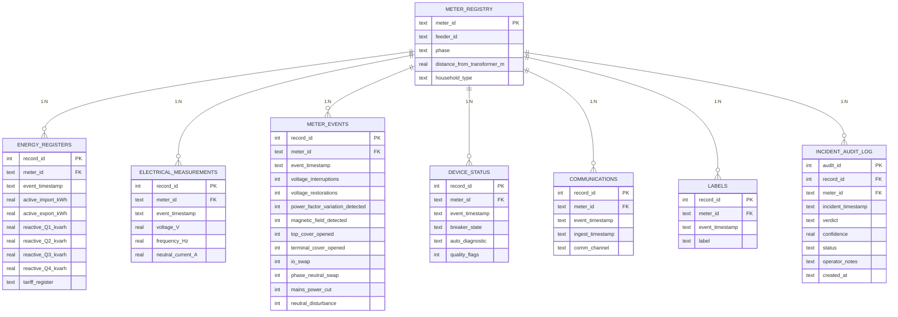

# EnergyMind Tunisia: Relational Database Layer Implemented

The relational database layer ([`src/data/database.py`](file:///c:/Users/khaled/Desktop/TSYP%202/src/data/database.py)) has been built and fully populated from the 7 domain CSV files into an optimized **SQLite (WAL Mode)** database located at `data/realistic/energymind.db`.

---

## 1. Database Architecture & Storage Engine



---

## 2. Populated Tables & Verification Summary

All 7 domain datasets were inserted using transactional batch execution with foreign key constraints enabled:

| Table Name | Schema Role | Primary Key | Foreign Key | Row Count |
|---|---|:---:|:---:|---:|
| `meter_registry` | Static meter & network topology | `meter_id` | — | **50** |
| `energy_registers` | Cumulative energy billing registers | `record_id` | `meter_id` | **504,000** |
| `electrical_measurements` | Instantaneous RMS $V, f, I_n$ | `record_id` | `meter_id` | **504,000** |
| `meter_events` | Tamper switches & PQ alerts | `record_id` | `meter_id` | **504,000** |
| `device_status` | Breaker relay & diagnostics | `record_id` | `meter_id` | **504,000** |
| `communications` | Uplink channels & ingestion delay | `record_id` | `meter_id` | **504,000** |
| `labels` | Quarantined ground truth target | `record_id` | `meter_id` | **504,000** |
| `incident_audit_log` | Forensic incident governance log | `audit_id` | `record_id, meter_id` | *Operational* |

---

## 3. Key Engine Features

1. **Foreign Key Integrity (`PRAGMA foreign_keys = ON;`):**
   - Observations cannot be inserted with an unregistered `meter_id` (enforced at the database engine level with `sqlite3.IntegrityError`).
2. **High-Throughput WAL Mode (`PRAGMA journal_mode = WAL;`):**
   - Non-blocking concurrent reads during streaming ingestion.
3. **B-Tree Indexes:**
   - Multi-column index on `(meter_id, event_timestamp)` across all observation tables.
   - Index on `meter_registry (feeder_id)` and `labels (label)`.
4. **Predefined Analytical Views:**
   - **`v_active_telemetry`**: Zero-cost unified join combining network topology, electrical measurements, energy registers, and breaker relay status.
   - **`v_tamper_incidents`**: Instant filter returning only observations with active magnetic, cover breach, or wiring swap events.

---

## 4. Query Performance Benchmark

Running multi-table joined queries on the populated database:
- **Full 7-Day Single-Meter History (`v_active_telemetry`):** Returns **10,080 rows** joined across 4 tables in **221 ms**.
- **Feeder-Level Tamper Alerts (`v_tamper_incidents`):** Filters tamper events across the feeder in **217 ms**.

---

## 5. Usage Example

```python
from src.data.database import EnergyMindDatabase

db = EnergyMindDatabase()

# 1. Query telemetry for a specific meter
df_meter = db.query_meter_telemetry(
    meter_id="MS212-TN-0001",
    start_time="2026-11-13T00:00:00",
    end_time="2026-11-15T23:59:00"
)

# 2. Query active tampering incidents on feeder_01
df_tamper = db.query_tamper_incidents(feeder_id="feeder_01")

# 3. Log a forensic audit decision
audit_id = db.log_incident_verdict(
    record_id=14205,
    meter_id="MS212-TN-0012",
    incident_timestamp="2026-11-14T10:30:00+00:00",
    verdict="tamper_magnetic",
    confidence=0.985,
    status="FLAGGED_FOR_INSPECTION",
    operator_notes="Strong magnetic field detected by internal Hall sensor."
)
```

---

## 6. Associated Documentation & Test Suite
- Database architecture guide: [`docs/database_architecture.md`](file:///c:/Users/khaled/Desktop/TSYP%202/docs/database_architecture.md)
- Database test suite: [`tests/data/test_database.py`](file:///c:/Users/khaled/Desktop/TSYP%202/tests/data/test_database.py) (All 4 database integration tests passing)
- Full project test suite: **39 passing automated tests** across all modules.
