# EnergyMind Tunisia: Realistic Neighborhood Data Architecture

## 1. Overview & Architecture Rationale

The **EnergyMind Tunisia** platform monitors low-voltage (LV) smart grids equipped with **Sagemcom MS212** single-phase DLMS/COSEM smart meters across the **STEG** (Société Tunisienne de l'Electricité et du Gaz) distribution network.

Prior to this architecture, neighborhood telemetry was stored in a single monolithic CSV file containing 504,000 rows and 33 parameters (111.8 MB). This monolithic pattern imposed significant memory bloat, unnecessary I/O overhead, and the risk of data leakage (such as target labels leaking into unsupervised models).

The modular domain-based data architecture addresses these issues:
1. **Separation of Concerns:** 33 established parameters are separated into 7 logical, domain-specific CSV files.
2. **Selective Domain Access:** Downstream ML models and monitoring microservices load only their required features and domains.
3. **Target Quarantining:** Ground-truth classification labels (`labels.csv`) are strictly segregated from telemetry features.
4. **Deterministic Reconstruction:** The monolithic 504,000-row, 33-column dataset can be recreated on-demand with 100% cell-by-cell numerical and semantic equality.
5. **Exact Preservation:** Zero columns modified, zero rows dropped, zero synthetic values invented, null values preserved.

---

## 2. Directory Layout

```
EnergyMind/
│
├── data/
│   └── realistic/
│       ├── raw/
│       │   └── neighborhood_dataset.csv       <- Untouched original raw dataset (504,000 rows, 33 cols)
│       │
│       ├── structured/
│       │   ├── meter_registry.csv             <- Static topology & meter specs (50 rows, 5 cols)
│       │   ├── energy_registers.csv           <- Cumulative billing registers (504,000 rows, 10 cols)
│       │   ├── electrical_measurements.csv    <- Instantaneous V, f, In (504,000 rows, 6 cols)
│       │   ├── meter_events.csv               <- Power quality & tamper flags (504,000 rows, 13 cols)
│       │   ├── device_status.csv              <- Breaker relay & diagnostics (504,000 rows, 6 cols)
│       │   ├── communications.csv             <- PLC/GPRS latency & channels (504,000 rows, 5 cols)
│       │   └── labels.csv                     <- Quarantined ground truth (504,000 rows, 4 cols)
│       │
│       └── processed/                         <- Location for future engineered features & model tensors
│
├── src/
│   └── data/
│       ├── __init__.py
│       ├── config.py                          <- Canonical schemas, paths, dtypes, domain catalog
│       ├── splitter.py                        <- Decomposes raw dataset into 7 domain CSVs
│       ├── reconstructor.py                  <- Deterministically reassembles raw dataset from structured files
│       ├── validator.py                       <- 8-point automated integrity verification suite
│       ├── loader.py                          <- Centralized high-performance query & selective loader
│       └── feature_engineering.py             <- On-demand physical electrical & statistical derivations
│
├── tests/
│   └── data/
│       ├── test_splitter.py
│       ├── test_loader.py
│       ├── test_reconstructor.py
│       └── test_integrity.py
│
└── docs/
    └── data_architecture.md
```

---

## 3. Relational Schema & Domain Specifications

```mermaid
erDiagram
    METER_REGISTRY ||--o{ ENERGY_REGISTERS : "monitors (1:N)"
    METER_REGISTRY ||--o{ ELECTRICAL_MEASUREMENTS : "monitors (1:N)"
    METER_REGISTRY ||--o{ METER_EVENTS : "logs (1:N)"
    METER_REGISTRY ||--o{ DEVICE_STATUS : "reports (1:N)"
    METER_REGISTRY ||--o{ COMMUNICATIONS : "transmits (1:N)"
    METER_REGISTRY ||--o{ LABELS : "classifies (1:N)"

    METER_REGISTRY {
        string meter_id PK "Unique Meter Identifier (MS212-TN-XXXX)"
        string feeder_id "Substation Feeder (FEEDER-01..03)"
        string phase "Grid Phase Connection (R, S, T)"
        float distance_from_transformer_m "Cable length in meters"
        string household_type "Residential / Commercial Profile"
    }

    ENERGY_REGISTERS {
        int record_id PK "Observation Unique Identifier (1..504000)"
        string meter_id FK "Meter Identifier"
        string event_timestamp "ISO8601 Sampling Timestamp"
        float active_import_kWh "Active Import Billing Energy"
        float active_export_kWh "Active Export Energy (Solar PV)"
        float reactive_Q1_kvarh "Inductive Active Energy (Q1)"
        float reactive_Q2_kvarh "Capacitive Export Energy (Q2)"
        float reactive_Q3_kvarh "Inductive Export Energy (Q3)"
        float reactive_Q4_kvarh "Capacitive Import Energy (Q4)"
        string tariff_register "STEG Tariff Code (Plein, Pointe, Jour, Nuit)"
    }

    ELECTRICAL_MEASUREMENTS {
        int record_id PK "Observation Unique Identifier (1..504000)"
        string meter_id FK "Meter Identifier"
        string event_timestamp "ISO8601 Sampling Timestamp"
        float voltage_V "RMS Voltage (Nominal 230 V)"
        float frequency_Hz "Grid Frequency (Nominal 50.0 Hz)"
        float neutral_current_A "Neutral Conductor RMS Current"
    }

    METER_EVENTS {
        int record_id PK "Observation Unique Identifier (1..504000)"
        string meter_id FK "Meter Identifier"
        string event_timestamp "ISO8601 Sampling Timestamp"
        int voltage_interruptions "SAG / Interruption Count"
        int voltage_restorations "Restoration Count"
        int power_factor_variation_detected "PF Threshold Alert"
        int magnetic_field_detected "Hall-effect Magnet Tamper Alert"
        int top_cover_opened "Main Cover Tamper Switch"
        int terminal_cover_opened "Terminal Block Cover Switch"
        int io_swap "Current Inversion Fraud Flag"
        int phase_neutral_swap "Phase/Neutral Cross Connection"
        int mains_power_cut "Grid Outage Alert"
        int neutral_disturbance "Neutral Line Tamper Indicator"
    }

    DEVICE_STATUS {
        int record_id PK "Observation Unique Identifier (1..504000)"
        string meter_id FK "Meter Identifier"
        string event_timestamp "ISO8601 Sampling Timestamp"
        string breaker_state "Latching Relay Status (CLOSED/OPEN)"
        string auto_diagnostic "DLMS Internal Diagnostics Code"
        int quality_flags "Bitmask Quality Flags"
    }

    COMMUNICATIONS {
        int record_id PK "Observation Unique Identifier (1..504000)"
        string meter_id FK "Meter Identifier"
        string event_timestamp "ISO8601 Sampling Timestamp"
        string ingest_timestamp "Gateway Ingestion Timestamp"
        string comm_channel "Protocol (GPRS, PLC-PRIME, PLC-G3)"
    }

    LABELS {
        int record_id PK "Observation Unique Identifier (1..504000)"
        string meter_id FK "Meter Identifier"
        string event_timestamp "ISO8601 Sampling Timestamp"
        string label "Ground-Truth Class (Normal, Fraud, Sag, etc.)"
    }
```



---

## 4. Key Relationships & Integrity Guarantees

1. **Primary Key `record_id`**: Uniquely identifies each 1-minute neighborhood observation across all 6 observation files ($N = 504,000$).
2. **Foreign Key `meter_id`**: Associates observation rows with the static meter specification table `meter_registry.csv` ($N = 50$).
3. **Deterministic Merge**: Joining all observation files on `record_id` and left-joining `meter_registry` on `meter_id` reconstructs the original dataset with exact column sequencing and zero lost records.
4. **Referential Integrity**: 100% of `meter_id` occurrences in observation files resolve to valid records in `meter_registry.csv`.

---

## 5. Machine Learning Domain Loading Patterns

By separating domains, models load only the memory footprint they need:

### A. Energy Forecasting & Loss Auditing
```python
from src.data.loader import NeighborhoodDataLoader

loader = NeighborhoodDataLoader()
# Loads energy registers joined with static network topology
df_energy = loader.load_for_energy_monitoring(
    feeder_ids=["FEEDER-01"],
    start_time="2026-03-01T00:00:00",
    end_time="2026-03-03T23:59:59"
)
```

### B. Electrical Power Quality & SAG/SWELL Detection
```python
# Loads voltage, frequency, neutral current and energy deltas without event bloat
df_pq = loader.load_for_electrical_anomaly_monitoring(
    meter_ids=["MS212-TN-0005", "MS212-TN-0012"]
)
```

### C. Electricity Theft & Non-Technical Loss (NTL) Detection
```python
# Loads physical measurements, energy registers, and tamper flags (labels quarantined unless requested)
df_tamper = loader.load_for_tampering_detection(
    include_status=True,
    include_labels=False # Target kept quarantined during inference
)
```

### D. Device Health & Predictive Maintenance
```python
# Loads internal diagnostic registers and communication protocol telemetry
df_health = loader.load_for_device_health()
```

---

## 6. Verification and Validation Protocols

The architecture includes `DataIntegrityValidator` in `src/data/validator.py`, which executes 8 automated checks:
1. **Row Count Audit:** Verifies 50 registry rows and 504,000 rows across all 6 observation tables.
2. **Column Schemas:** Confirms exact expected column sets and ordering.
3. **Primary Key Uniqueness:** Verifies 504,000 distinct `record_id` values per observation file.
4. **Referential Integrity:** Zero dangling foreign keys (`meter_id`).
5. **Null Parity:** Preserves exact missing value counts for all 33 columns.
6. **Value Equality:** Confirms cell-by-cell numerical ($<10^{-9}$) and string equality against the raw source.
7. **Duplicate Detection:** Confirms zero duplicated records.
8. **Timestamp Alignment:** Confirms `event_timestamp` values align across all domain tables.
