# EnergyMind Tunisia — Data Relationships & Topology

This document details the relational architecture, primary/foreign key contracts, cardinality, and join recipes governing the 7 modular data domains.

---

## 1. Entity-Relationship Diagram

```mermaid
erDiagram
    METER_REGISTRY ||--o{ ENERGY_REGISTERS : "generates (1:N)"
    METER_REGISTRY ||--o{ ELECTRICAL_MEASUREMENTS : "generates (1:N)"
    METER_REGISTRY ||--o{ METER_EVENTS : "logs (1:N)"
    METER_REGISTRY ||--o{ DEVICE_STATUS : "reports (1:N)"
    METER_REGISTRY ||--o{ COMMUNICATIONS : "transmits (1:N)"
    METER_REGISTRY ||--o{ LABELS : "classifies (1:N)"

    METER_REGISTRY {
        string meter_id PK "Hardware Identifier (MS212-TN-0001..0050)"
        string feeder_id "Substation Feeder (feeder_01..03)"
        string phase "Phase Connection (L1, L2, L3)"
        float distance_from_transformer_m "Cable length in meters"
        string household_type "Residential Consumer Profile"
    }

    ENERGY_REGISTERS {
        int record_id PK "Observation ID (1..504000)"
        string meter_id FK "Meter Identifier"
        string event_timestamp "ISO8601 Sampling Timestamp"
        float active_import_kWh "Active Import (kWh)"
        float active_export_kWh "Active Export (kWh)"
        float reactive_Q1_kvarh "Reactive Q1 (kvarh)"
        float reactive_Q2_kvarh "Reactive Q2 (kvarh)"
        float reactive_Q3_kvarh "Reactive Q3 (kvarh)"
        float reactive_Q4_kvarh "Reactive Q4 (kvarh)"
        string tariff_register "STEG Tariff Code (T1..T3)"
    }

    ELECTRICAL_MEASUREMENTS {
        int record_id PK "Observation ID (1..504000)"
        string meter_id FK "Meter Identifier"
        string event_timestamp "ISO8601 Sampling Timestamp"
        float voltage_V "RMS Voltage (V)"
        float frequency_Hz "Grid Frequency (Hz)"
        float neutral_current_A "Neutral Current (A)"
    }

    METER_EVENTS {
        int record_id PK "Observation ID (1..504000)"
        string meter_id FK "Meter Identifier"
        string event_timestamp "ISO8601 Sampling Timestamp"
        int voltage_interruptions "Interruption Count"
        int voltage_restorations "Restoration Count"
        int power_factor_variation_detected "PF Anomaly Flag"
        int magnetic_field_detected "Magnetic Tamper Flag"
        int top_cover_opened "Top Cover Tamper Flag"
        int terminal_cover_opened "Terminal Cover Tamper Flag"
        int io_swap "I/O Inversion Flag"
        int phase_neutral_swap "Phase/Neutral Swap Flag"
        int mains_power_cut "Grid Outage Flag"
        int neutral_disturbance "Neutral Line Tamper Flag"
    }

    DEVICE_STATUS {
        int record_id PK "Observation ID (1..504000)"
        string meter_id FK "Meter Identifier"
        string event_timestamp "ISO8601 Sampling Timestamp"
        string breaker_state "Relay State (CLOSED/OPEN)"
        string auto_diagnostic "DLMS Health (OK/WARN/ERR/ALARM)"
        int quality_flags "Validation Bitmask"
    }

    COMMUNICATIONS {
        int record_id PK "Observation ID (1..504000)"
        string meter_id FK "Meter Identifier"
        string event_timestamp "ISO8601 Sampling Timestamp"
        string ingest_timestamp "Gateway Arrival Timestamp"
        string comm_channel "Protocol (Cellular-4G, G3-PLC, W-Mbus)"
    }

    LABELS {
        int record_id PK "Observation ID (1..504000)"
        string meter_id FK "Meter Identifier"
        string event_timestamp "ISO8601 Sampling Timestamp"
        string label "Ground-Truth Class (Normal, Fraud, Sag)"
    }
```



---

## 2. Key Architecture & Constraints

### Primary Keys
- **Static Metadata (`meter_registry`):** `meter_id` is the primary key. Exactly 50 unique rows exist, representing the 50 smart meters in the neighborhood.
- **Observation-Level Domains:** `record_id` is the primary key across `energy_registers`, `electrical_measurements`, `meter_events`, `device_status`, `communications`, and `labels`. Exactly 504,000 sequential, unique records exist in each file ($50 \text{ meters} \times 7 \text{ days} \times 1440 \text{ minutes}$).

### Foreign Keys & Referential Integrity
- Every observation table contains `meter_id` as a foreign key referencing `meter_registry.meter_id`.
- **Zero Orphan Guarantee:** Referential integrity validation ensures that 100% of observations map to a registered meter in `meter_registry.csv`.

---

## 3. Join Recipes

### A. Synchronous Cross-Domain Observation Join
Observation-level domains can be joined directly on `record_id` via an `INNER JOIN`:
```python
import pandas as pd

df_elec = pd.read_csv("data/realistic/structured/electrical_measurements.csv")
df_events = pd.read_csv("data/realistic/structured/meter_events.csv")

# Join on record_id, preserving meter_id and event_timestamp
merged = df_elec.merge(
    df_events.drop(columns=["meter_id", "event_timestamp"]),
    on="record_id",
    how="inner"
)
```

### B. Network Topology Enrichment
To attach meter feeder, phase, and transformer distance to observations:
```python
df_reg = pd.read_csv("data/realistic/structured/meter_registry.csv")

enriched = merged.merge(
    df_reg,
    on="meter_id",
    how="left"
)
```

### C. Using the Centralized Loader
The recommended method is using `NeighborhoodDataLoader`, which handles keys, consistency checks, and joins automatically:
```python
from src.data.loader import NeighborhoodDataLoader

loader = NeighborhoodDataLoader()
df = loader.load_domains(
    domain_names=["electrical_measurements", "energy_registers"],
    include_registry=True,
    feeder_ids=["feeder_01"]
)
```
