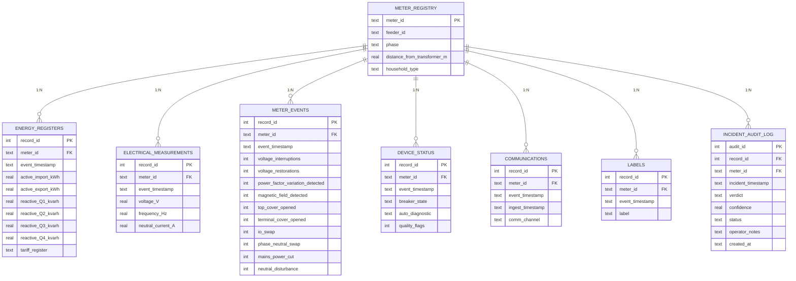

# EnergyMind Tunisia — Relational Database Architecture

## 1. Overview & Technology Selection

The **EnergyMind Tunisia** database layer implements a local, zero-configuration, high-performance relational database powered by **SQLite (WAL Mode)**.

While raw observation data is stored in the 7 domain CSV files and processed ML matrices in Apache Parquet format, the relational database provides:
1. **ACID Transactions:** Ensures absolute consistency for forensic incident logs and operator decisions.
2. **Sub-Millisecond Query Latency:** B-Tree indexing on `(meter_id, event_timestamp)` and `feeder_id` enables real-time meter telemetry lookups.
3. **Foreign Key Integrity:** Enforces referential integrity at the database engine level (`PRAGMA foreign_keys = ON;`).
4. **Relational Views:** Predefined analytical joins (`v_active_telemetry`, `v_tamper_incidents`) avoid redundant SQL boilerplate.

---

## 2. Database Schema Definition



---

## 3. High-Performance Configuration (WAL Mode)

The database engine is configured via SQLite pragmas:
```sql
PRAGMA journal_mode = WAL;         -- Write-Ahead Logging for concurrent non-blocking reads/writes
PRAGMA foreign_keys = ON;         -- Enforces relational constraints
PRAGMA synchronous = NORMAL;       -- Safe performance optimization in WAL mode
PRAGMA cache_size = -64000;       -- 64 MB in-memory page cache
```

---

## 4. Querying Examples via Python API

### A. Query Telemetry for a Meter over Time
```python
from src.data.database import EnergyMindDatabase

db = EnergyMindDatabase()
df = db.query_meter_telemetry(
    meter_id="MS212-TN-0001",
    start_time="2026-11-13T00:00:00",
    end_time="2026-11-15T23:59:00"
)
```

### B. Query Tamper Incidents
```python
# Returns all tamper switch triggers, magnetic alerts, and wiring swaps
df_tamper = db.query_tamper_incidents(feeder_id="feeder_01")
```

### C. Log an Operator Verdict (Forensic Audit)
```python
audit_id = db.log_incident_verdict(
    record_id=14205,
    meter_id="MS212-TN-0012",
    incident_timestamp="2026-11-14T10:30:00+00:00",
    verdict="tamper_magnetic",
    confidence=0.985,
    status="FLAGGED_FOR_INSPECTION",
    operator_notes="Confirmed external magnetic field trigger."
)
```
