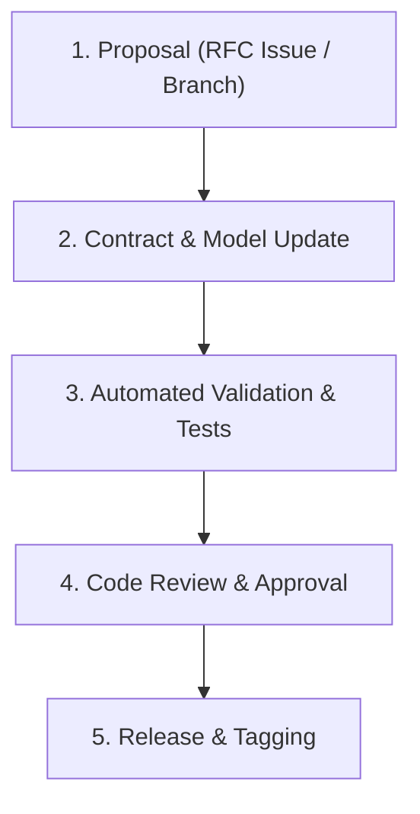

# EnergyMind Tunisia — Schema Versioning & Evolution Policy

This document defines the versioning guidelines, change management workflow, and compatibility guarantees for the **EnergyMind Tunisia** data schemas and contracts.

---

## 1. Semantic Versioning Specification (SemVer)

All EnergyMind data contracts in `schemas/*.schema.yaml` adhere strictly to Semantic Versioning (`MAJOR.MINOR.PATCH`):

```
v MAJOR . MINOR . PATCH
    │       │       └── Non-breaking documentation, unit description, or constraint clarification.
    │       └────────── Backward-compatible additions (new optional columns, widened bounds).
    └────────────────── Breaking changes (column dropped, renamed, key changed, types changed).
```

### A. MAJOR (Breaking Changes)
Triggers a MAJOR version bump (e.g., `1.0.0` -> `2.0.0`):
- Removing any established column.
- Renaming an established column.
- Changing a column's data type (e.g., `int` -> `string`).
- Narrowing allowed categorical values or valid ranges.
- Changing primary or foreign keys.
- Changing nullability from `nullable: true` to `nullable: false`.

### B. MINOR (Backward-Compatible Extensions)
Triggers a MINOR version bump (e.g., `1.0.0` -> `1.1.0`):
- Adding a new optional column to an existing domain.
- Adding a new domain schema file (e.g., `solar_inverters.schema.yaml`).
- Widening a numerical range bound (e.g., maximum distance increased).
- Changing nullability from `nullable: false` to `nullable: true`.
- Adding new permitted categorical values to an existing enum.

### C. PATCH (Non-Breaking Refinements)
Triggers a PATCH version bump (e.g., `1.0.0` -> `1.0.1`):
- Updating field descriptions or documentation.
- Clarifying measurement units without changing semantics.
- Adding usage examples or DLMS/COSEM OBIS cross-references.

---

## 2. Schema Change Management Workflow

Any change to the schemas must follow a 4-step governance process:



1. **Proposal:** Developer opens an issue or pull request proposing the schema modification, citing grid engineering requirements (e.g., STEG tariff revision).
2. **Contract Update:** Update the authoritative YAML schema in `schemas/<domain>.schema.yaml` and increment version in `schemas/schema_version.yaml`. Update corresponding Pydantic models in `src/data/models.py`.
3. **Automated Verification:** Execute the test suite:
   ```powershell
   pytest tests/data/ -v
   ```
4. **Approval & Merging:** Breaking changes (MAJOR) require approval from the Data Architecture Lead and Lead ML Engineer to prevent pipeline degradation.

---

## 3. Backward Compatibility & Deprecation Policy

- **No Silent Breaks:** No column may be dropped or renamed without a deprecation window of at least one MINOR release.
- **Quarantine Invariance:** Ground-truth classification targets (`labels.csv`) must never be co-located with telemetry features.
- **Immutability of Historical Datasets:** Historical raw telemetry datasets (such as `data/realistic/raw/neighborhood_dataset.csv`) remain immutable. Version changes apply to incoming telemetry streams and newly exported datasets.
